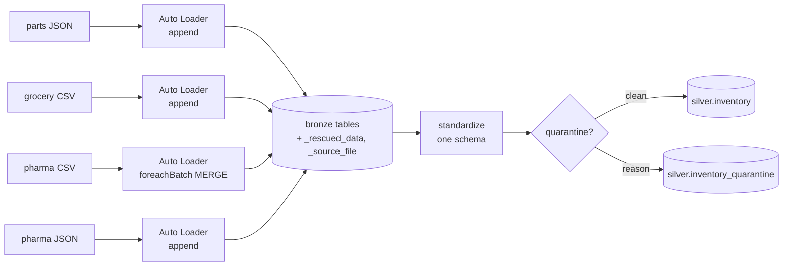

# Databricks Auto Loader patterns

[](https://github.com/suriyalakshmi-chandrasekar/databricks-autoloader-patterns/actions/workflows/ci.yml)
  

File ingestion the way real feeds behave: several suppliers, each with its **own format, folder layout and column names**, and files that **change shape, arrive broken, or get re-sent**.

**Stop tracking processed files in a metadata table.** Auto Loader's checkpoint already knows what it has read, and does it better.

## The scenario

| Feed | Format | Folder layout | Problems over 30 days |
|---|---|---|---|
| Auto-parts distributor | JSON lines | flat, one file per day | new columns on day 11 and day 21; **half-written records** on days 26–28 |
| Grocery chain | CSV, pipe-delimited | `YYYY/MM/DD/` | a new column on day 11 |
| Pharma distributor | CSV **and** JSON mixed | one folder per vendor | one vendor **switches to nested JSON** on day 21; another **re-sends a corrected file** |

Each feed is one entry in `config/sources.yaml`: format, path, glob filter, reader options, schema hints, append or merge, and the mapping onto one unified schema. All supplier names are fictional.

## The patterns

| Problem | Pattern |
|---|---|
| Knowing which files were already loaded | **The Auto Loader checkpoint**: exactly-once file tracking. Re-runs process nothing; new files are picked up incrementally. |
| A feed adds a column | `schemaEvolutionMode = addNewColumns`: the stream stops once, records the new schema, and the job's retry continues with the column added. No pipeline change needed. |
| Values that don't fit the schema (wrong type, nested, unexpected fields, broken lines) | `rescuedDataColumn = _rescued_data`: nothing is dropped. The row lands with its raw data kept. |
| Mixed formats in one folder | A separate stream per format with `pathGlobFilter` (`*.csv`, `*.json`), each with its own schema location |
| A vendor re-sends a corrected file | `foreachBatch` + **MERGE** on business keys; the newest file wins within a batch |
| Different column names per feed | **Standardize**: map each feed onto one schema and keep lineage (`source`, `_source_file`) |
| Bad rows | **Quarantine with a reason**: `NESTED_STRUCTURE`, `FIELD_RENAMED`, `TYPE_MISMATCH`, `UNEXPECTED_FIELDS`, `MALFORMED_RECORD`, `MISSING_REQUIRED_FIELDS`. Clean rows go to silver; quarantined rows go to a separate table for follow-up. |
| Knowing what drifted | `new_columns()` schema audit against a baseline |



## Run it

**On Databricks** (Auto Loader):

```bash
python -m alpatterns.generate --out ./landing --days 30    # then upload to a Volume
databricks bundle deploy -t dev && databricks bundle run inventory_feeds -t dev
```

**Locally or in CI:** the same pipeline runs on Spark's built-in file streaming (`engine="spark"`), with PERMISSIVE parsing feeding `_rescued_data`. Everything except schema evolution behaves the same, so the rest of the pipeline is testable without a workspace.

```bash
pip install -e ".[spark,dev]"
pytest -v
```

## What the tests check

- **Unit** (pure): config validation, the quarantine classifier for every reason, the drift report, and the generator really producing each scenario.
- **Spark** (CI), on 30 days of generated files:
  - exact row counts per feed
  - the corrected re-send **updates** 20 rows instead of duplicating them
  - 3 corrupt lines are **kept**, with their raw text in `_rescued_data`
  - a re-run reads **nothing new**, and day 31 is picked up **incrementally**
  - standardize + quarantine routes exactly the 3 malformed rows and the 220 nested rows to quarantine, and every other row to clean

## Honest scope

Auto Loader (`cloudFiles`) only exists on Databricks. CI therefore tests the logic around it with open-source Spark streaming. The Auto Loader options in `ingest.py` (schema location, evolution mode, schema hints, rescued data) are the ones I use on Databricks, but CI can't run them.

## Timeline

I built this as a hands-on Auto Loader deep dive in **July 2026**: multi-customer supply chain feeds with schema evolution, rescued data and quarantine. I also wrote it up as an 11-page LinkedIn carousel, *Don't track processed files using a metadata table*. This repository is a **cleaned-up open-source version (Nov 2026)**, with fictional suppliers, generated data and CI.

## Author

**Suriyalakshmi Chandrasekar**: Technical Lead, Data Engineering · Databricks Certified Data Engineer Professional
[LinkedIn](https://www.linkedin.com/in/suriyalakshmi-chandrasekar) · [GitHub](https://github.com/suriyalakshmi-chandrasekar)

MIT licensed.
